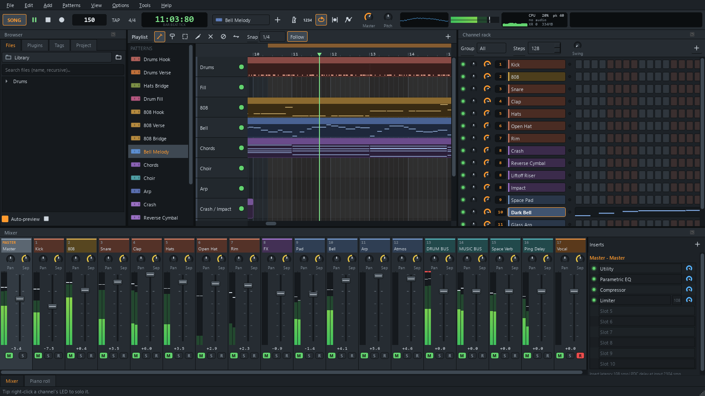

# T&A Studio

Free music production software for Windows. Program beats in the step sequencer and piano roll,
arrange them in the playlist, and mix with the built-in instruments and effects. You can also
make music with friends in real time.

[Download](https://github.com/TA-Studio-App/releases/releases/latest/download/TA-Studio-Setup.exe) ·
[Website](https://tastudio-app.netlify.app) · [Discord](https://discord.gg/vX823X3GG7)



## Watch T&A Studio Tutorial Video

[Watch on YouTube](https://www.youtube.com/watch?v=6L-YRObYUCE)

## Download

**[Download the latest version](https://github.com/TA-Studio-App/releases/releases/latest/download/TA-Studio-Setup.exe)**
(Windows 10 or 11, 64-bit)

What's new in each version, and older versions, are on the
[Releases page](https://github.com/TA-Studio-App/releases/releases).

## Community

Join the **[T&A Studio Discord](https://discord.gg/vX823X3GG7)** to get help, report bugs,
suggest features, share your music and find people to collaborate with.

## Installing

1. Run `TA-Studio-Setup.exe`. It installs for your user account only, so it doesn't need
   administrator rights.
2. If Windows SmartScreen appears, click **More info**, then **Run anyway**. The warning appears
   because the installer isn't code-signed yet.
3. Wait about 15 seconds at the end while the audio engine is prepared. This only happens once.
4. Start T&A Studio. The beginner's guide opens on first launch.

To update, run the new installer. Your projects and settings are kept.

### Checking your download

Each file on the [Releases page](https://github.com/TA-Studio-App/releases/releases) shows its
SHA-256 checksum. To compare, open Command Prompt in your Downloads folder and run:

```
certutil -hashfile TA-Studio-Setup.exe SHA256
```

If the result doesn't match, delete the file and download it again.

## What's included

- Channel rack with a step sequencer, a piano roll and a playlist with audio and automation clips
- Mixer with routing, sends, sidechain and plugin delay compensation
- Five instruments: Analog Synth, Wavetable Synth, Sampler, Drum Sampler and Drum Machine
- 27 effects, including parametric EQ, multiband compressor, true-peak limiter, reverb and Auto-Tune
- VST3 instrument and effect hosting, including sidechain inputs and multi-output instruments
- Real-time collaboration with friends over [Tailscale](https://tailscale.com)
- Export to WAV, FLAC, OGG and MP3, with stems and a loudness report
- A built-in beginner's guide with 17 lessons

## System requirements

| | |
|---|---|
| Operating system | Windows 10 or 11, 64-bit |
| Processor | Dual-core or better; quad-core recommended for large projects |
| Memory | 4 GB RAM; 8 GB recommended |
| Disk space | About 400 MB, plus space for projects |
| Audio | Any sound card or headset |
| MIDI | Optional; any USB MIDI keyboard or controller |

## Licence

T&A Studio is free for personal and commercial use, and everything you make with it is yours.
It is closed source: this repository only hosts the installers, not the program's source code.
The licence agreement is shown by the installer and included with each release as `LICENSE.txt`.

T&A Studio includes open-source components, each under its own licence. They are listed in
`THIRD_PARTY_NOTICES.txt`, which comes with the program (Help > Third-party notices) and with
each release. Source code for the components under the GNU Lesser General Public License is
installed in the `source` folder and also attached to each release.

VST is a registered trademark of Steinberg Media Technologies GmbH. Tailscale is a trademark of
Tailscale Inc. T&A Studio is not affiliated with Tailscale Inc.
